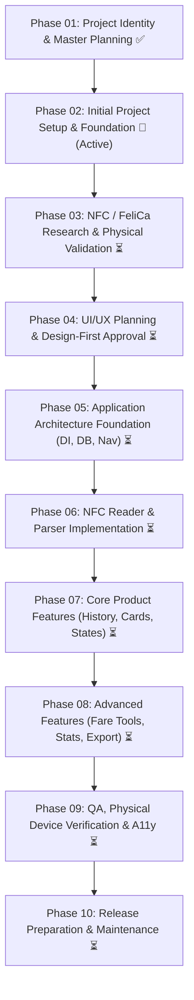

# TransitMate — Project Workflow & Development Protocol

**Document Version:** 1.0  
**Last Updated:** 10 November 2026  
**Status:** Active Protocol  

---

## 1. Development Lifecycle & Phase Gates

TransitMate follows an evidence-led, 10-phase development sequence. An agent or developer must **never** skip a phase gate or start feature implementation prematurely:

---

## 2. Git & Version Control Protocol

### Branch Strategy
- `main`: Always protected, stable, and buildable.
- `feat/*`: Feature branches for substantial development iterations.
- `docs/*`: Dedicated documentation updates.
- `fix/*`: Bug fixes and regression repairs.

### Commit Conventions
All commit messages must follow structured prefixing:
- `docs:` Documentation, specification, or planning updates.
- `build:` Gradle toolchain, dependencies, Version Catalog, or CI changes.
- `feat:` New production feature or architectural component.
- `fix:` Bug fix or error resolution.
- `test:` Unit tests, instrumented tests, or test fixtures.
- `refactor:` Code structure refactoring with no behavioral change.
- `chore:` Maintenance, resource updates, or asset generation.

### Strict Commit Restrictions
- **NEVER** commit `local.properties` or personal SDK paths.
- **NEVER** commit API keys, signing keystores, or passwords.
- **NEVER** commit raw unredacted personal transit card IDs or private travel histories.
- **NEVER** force-push (`--force`) to shared branches.

---

## 3. Mandatory Quality Gates

Before declaring any task or phase complete:

1. **Clean Build:** `./gradlew clean` must execute with code 0.
2. **Compilation:** `./gradlew assembleDebug` must compile and generate a valid debug APK.
3. **Unit Tests:** `./gradlew testDebugUnitTest` must pass with 100% test success (0 failures, 0 errors).
4. **Manifest Inspection:** Permissions, features, and application ID must be validated against `aapt2` or `apkanalyzer`.
5. **Documentation Sync:** `PROJECT_PROGRESS.md` must be updated with timestamps, exact commands, and empirical results.

---

## 4. Agent Handover Protocol

When transitioning work between AI agents or human developers:
1. Review `PROJECT_PROGRESS.md` to identify current phase and recent accomplishments.
2. Verify `git status` and pull latest changes from `origin/main`.
3. Run `./gradlew testDebugUnitTest` to establish a verified baseline.
4. Execute only the next recommended task documented in the progress log.
