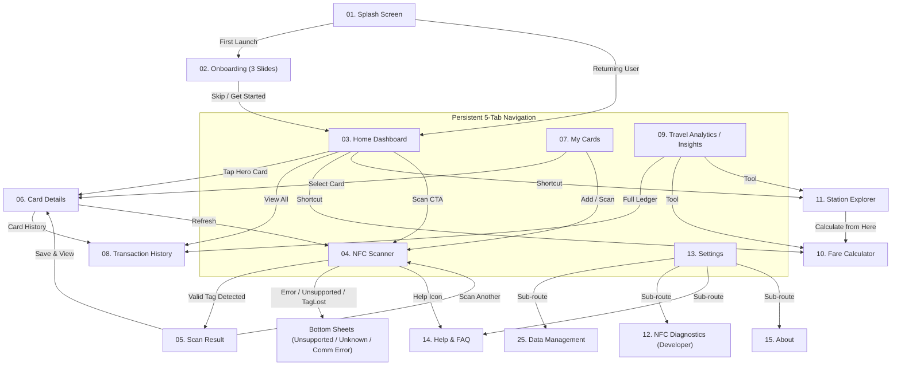

# TransitMate — UI/UX Design & Interaction Specification

**Document Version:** 1.0  
**Date:** 16 November 2026  
**Stage:** Stage 3 — UI/UX Architecture & Specification  
**Status:** Finalized Specification — Pending Owner Sign-Off Before Stage 4  
**Related Specifications:**
- [PROJECT_MASTER_PLAN.md](file:///Users/betopia/StudioProjects/Projects_Another/TransitMate/PROJECT_MASTER_PLAN.md)
- [PROJECT_UI_AUDIT.md](file:///Users/betopia/StudioProjects/Projects_Another/TransitMate/PROJECT_UI_AUDIT.md)
- [design/DESIGN_SYSTEM.md](file:///Users/betopia/StudioProjects/Projects_Another/TransitMate/design/DESIGN_SYSTEM.md)
- [design/SCREEN_REQUIREMENTS.md](file:///Users/betopia/StudioProjects/Projects_Another/TransitMate/design/SCREEN_REQUIREMENTS.md)

---

## 1. UX Strategy & Core Product Pillars

TransitMate serves Dhaka Metro Rail (MRT Pass) and Rapid Pass commuters with an offline-first, no-account Android companion utility. Every design decision serves four pillars:

1. **Zero-Friction Commuter Utility:** Checking card status, launching an NFC scan, or verifying a metro fare must work within 1–2 taps—even underground or without cellular connectivity.
2. **Honest Capability Transparency:** Physical hardware testing in Phase 03 proved `NfcF` detection and 8-byte `IDm` reading on Rapid Pass (`System Code 0x90E3`). Because balance and transaction block parsing are not yet validated for production, the UI must **explicitly separate Card Detection, Card Recognition, Balance Reading, and History Reading**, never mimicking unverified numbers.
3. **Calm, Neutral Minimalism:** Replaces neon cyan and glowing cyberpunk dark surfaces with a **Neutral Charcoal/Graphite** Dark Theme and **Warm Off-White** Light Theme tailored for daily readability.
4. **Inclusive Non-NFC Support:** Because `android.hardware.nfc` is optional (`required="false"`), users without NFC hardware never hit a dead end—**Fare Calculator** and **Station Explorer** remain first-class offline utilities accessible directly from Home and Insights.

---

## 2. Information Architecture & Navigation Graph

### 2.1 Five-Destination Persistent Bottom Navigation
All top-level screens share an identical Material 3 `NavigationBar`:

| Tab Index | Route ID | Label (EN / বাংলা) | Purpose |
|:---:|---|---|---|
| 1 | `home` | Home / হোম | Primary card status, quick scan CTA, shortcuts, recent activity |
| 2 | `my_cards` | My Cards / কার্ডসমূহ | Multi-card organizer, primary pin toggle, rename/delete |
| 3 | `scan` | Scan / স্ক্যান | Live Reader Mode scanner with antenna placement guidance |
| 4 | `insights` | Insights / তথ্য | Spending trends, trip summaries, links to History & tools |
| 5 | `settings` | Settings / সেটিংস | Theme, language, data management, privacy, help, diagnostics |

### 2.2 Navigation Flow Diagram


### 2.3 Back-Stack & State Restoration Rules
- Switching between the 5 Bottom Navigation tabs preserves each tab's state cleanly (`saveState = true`, `restoreState = true`, `launchSingleTop = true`).
- Tapping system Back on any non-Home tab returns cleanly to `Home` before exiting.
- Push routes (`Scan Result`, `Card Details`, `Transaction History`, `Fare Calculator`, `Station Explorer`, `Data Management`, `NFC Diagnostics`, `Help & FAQ`, `About`) hide the Bottom Navigation Bar and show a standard `TopAppBar` with a `48.dp` Back icon button so tasks remain focused and clutter-free.
- Predictive Back gestures work cleanly on Android 14+ without interrupting active `NfcAdapter.disableReaderMode` cleanup in `onPause()`.

---

## 3. Critical End-to-End User Flows

### Flow A: First-Time User Launch & Non-NFC Resilience
1. User opens TransitMate -> **Splash (01)** loads preferences in `< 800ms`.
2. First-time user sees **Onboarding (02)** (3 concise slides explaining physical tap zone, offline privacy, and transparent capabilities) and taps `Get Started` or `Skip`.
3. Lands on **Home Dashboard (03)**:
   - If NFC is **Available**: Primary Card placeholder prompts `[ Scan Your First Card ]`.
   - If NFC is **Disabled**: Subtle Warning Banner displays `[ Open NFC Settings ]`; `onResume()` automatically clears the banner when the user turns NFC on and returns.
   - If NFC is **Not Supported**: Clean Info Banner explains NFC scanning is unavailable on this handset, highlighting **Fare Calculator** and **Station Explorer** right below.

### Flow B: Contactless Card Scan & Honest Capability Separation
1. User enters **NFC Scanner (04)** via the `Scan` tab or Home CTA.
2. `NfcAdapter.enableReaderMode` activates strictly on foreground (`NFC_F | NFC_A | SKIP_NDEF_CHECK | NO_PLATFORM_SOUNDS`).
3. User holds Rapid Pass / MRT Pass behind the phone:
   - **Success (`NfcF` discovered):** Smooth `260ms` confirmation transitions to **Scan Result (05)** displaying:
     - `Card Detection`: *Successful*
     - `Technology`: *FeliCa (NFC-F)*
     - `Card Recognition`: *Unidentified* (until issuer verification rules are confirmed in Phase 06) or verified authority
     - `Balance`: Honest `"Balance Not Available"` card (until Phase 06 parser verification) OR verified `৳` balance
     - Privacy-masked identifier (`01:27:••:••:••:••:••:A0`)
   - **Tag Moved Early (`TagLostException`):** Shows **NFC Communication Error Bottom Sheet** explaining to hold steady for 1–2 seconds with `[ Try Again ]`.
   - **Bank Card / Other Tech (`IsoDep`, `MifareClassic`):** Shows **Unsupported Card Bottom Sheet** cleanly without saving noise.
4. User optionally taps `[ Save to My Cards ]`, assigns a custom nickname in **Rename Card Dialog**, and manages it under **My Cards (07)**.

### Flow C: Developer Diagnostics Isolation (Zero Consumer Leakage)
- Raw `IDm` inspection, `System Code` (`0x90E3` cleanly formatted without mid-word colons), `PMm` (`01:46:42:45:45:46:9B:FF`), `techList`, `Scan Counter`, and `RF Link Error Traces` **never** appear on `Home`, `Scanner`, `Scan Result`, or `Card Details`.
- All diagnostic output lives exclusively inside **Settings (13) -> Advanced -> NFC Diagnostics (12)**, keeping physical validation seamless for the developer while keeping the consumer experience clean and understandable.

---

## 4. Reference Design Transformation Strategy

All 5 existing reference images inside `design/ui_designs/` are treated strictly as layout inspiration—not production copy targets:

| Reference File | Elements Adopted | Elements Transformed / Removed |
|---|---|---|
| `Neon Transit App Onboarding Duo.png` | Clean centered splash hierarchy; phone-to-card alignment graphic; 3-dot indicator; top-right `Skip` | Replaced `MetroSync BD` -> `TransitMate`; removed neon cyan glow & train wallpaper; switched bright cyan pill CTA to muted Teal (`#2FA497`/`#12746A`) |
| `MetroSync BD_ Dual-Theme Transit Wallet.png` | Hero Card hierarchy (`Active` pill, masked ID, prominent balance zone); Recent Activity preview + `View All` | Removed user avatar, `"Hello, Siam! 👋"` greeting & notification bell (no-account product); removed fake `৳ 150` balance; replaced center glow orb with clean Scan CTA; aligned 5-tab bar to `Home \| My Cards \| Scan \| Insights \| Settings` |
| `Dual-Theme NFC Scanner UI.png` | Top Bar (`Back`, Title, Help `?`); phone-card diagram; polling pill; bottom `Cancel` button | Removed neon concentric rings & city skyline background; updated copy to support both **MRT Pass & Rapid Pass** |
| `Dual-Mode Transit Card Scan UI.png` | Visual card preview -> compact ID pill -> Balance status card -> confirmation banner | Replaced iOS notch/home bar with Android Edge-to-Edge bars; separated Recognition & Balance Availability honestly; removed bright blue gradients |
| `Transit History App_ Dark and Light Themes.png` | Top `Total Trips \| Total Spent` KPI strip; date grouping (`Today`/`Yesterday`); subtle vertical timeline dots; filter icon | Fixed 4-tab nav mismatch to match unified 5-tab shell; removed saturated gradient summary box & train watermark in Light Mode |

---

## 5. Technical NFC Separation Contract for Stage 6 Implementation

When implementation begins in Stage 6 (after Design System & Stage 4/5 sign-off):
- **Preserve Working Core:** `AndroidNfcAvailabilityChecker`, `NfcAvailabilityRepository`, and the `NfcAdapter.enableReaderMode` polling engine in `NfcDiagnosticReader.kt` remain functionally intact.
- **Split Domain Projections:**
  - `CardScanOutcome` (Consumer UI): `status`, `technologyLabel`, `recognitionStatus`, `maskedIdentifier`, `verifiedBalance`, `scannedAt`.
  - `NfcDiagnosticData` (Diagnostics UI #12 only): `techList`, `idmRedacted`, `systemCodeHex` (formatted as `0x90E3`), `manufacturerPmmHex`, `scanCount`, `errorMessage`.
- **Clean Architecture Boundary:** No `android.nfc.*` imports enter `domain/` or `feature/*/Screen.kt` composables.

---

## 6. Localization & Accessibility Rules

1. **Dynamic Language Switching (EN / বাংলা):** Every screen, button, error sheet, station name, and accessibility description uses Android string resources (`values/strings.xml` and `values-bn/strings.xml`).
2. **Bangla Layout Safety:** Multi-line wrapping (`maxLines = 2` on labels/chips), `1.4x–1.5x` line heights, and `defaultMinSize` buttons prevent vertical clipping of `যুক্তবর্ণ` and vowel signs.
3. **TalkBack & Dynamic Font Support:** Minimum `48.dp` touch targets, descriptive `contentDescription`, `LiveRegionMode.Polite` for NFC state transitions, and layout testing up to `1.5x` font scale.

---

## 7. Stage 4 Proposed Design Folder Structure & Presentation Standard

Existing reference files in `design/ui_designs/` stay untouched during Stage 2 & Stage 3. Once Stage 4 (Design Generation) is approved, outputs will be organized inside `design/ui_designs/` as follows:

```text
design/ui_designs/
├── references/                     # Archived original 5 reference PNGs (moved/preserved cleanly at Stage 4 start)
├── design_system/                  # Token sheet & shared component showcase (light + dark)
├── 01_splash_onboarding/           # splash_light.png, splash_dark.png, onboarding_light.png, onboarding_dark.png
├── 02_home/                        # home_light.png, home_dark.png
├── 03_my_cards/                    # my_cards_light.png, my_cards_dark.png
├── 04_nfc_scanner/                 # scanner_light.png, scanner_dark.png
├── 05_scan_result/                 # scan_result_light.png, scan_result_dark.png
├── 06_card_details/                # card_details_light.png, card_details_dark.png
├── 07_transaction_history/         # history_light.png, history_dark.png
├── 08_insights/                    # insights_light.png, insights_dark.png
├── 09_fare_calculator/             # fare_calculator_light.png, fare_calculator_dark.png
├── 10_station_explorer/            # station_explorer_light.png, station_explorer_dark.png
├── 11_nfc_diagnostics/             # diagnostics_light.png, diagnostics_dark.png
├── 12_settings/                    # settings_light.png, settings_dark.png, data_management_light.png, data_management_dark.png
├── 13_help_about/                  # help_faq_light.png, help_faq_dark.png, about_light.png, about_dark.png
└── supporting_states/              # empty_states.png, scanner_error_sheets.png, dialogs_pickers.png
```

### Stage 4 Generation Standard
- **Device Frame:** Uniform Android Edge-to-Edge smartphone frame (`9:19.5` / `1080x2340` aspect), Android status bar & gesture pill (zero iOS chrome).
- **Theme Parity:** Every screen generated in paired **`*_light.png`** (`#F6F7F8` / `#FFFFFF`) and **`*_dark.png`** (`#111315` / `#191C1F`) variants.
- **Screen-by-Screen Sequencing:** Generate **Core Screens (01–06)** first, verify visual token consistency, then proceed sequentially through **07–15** and **Supporting States**.
