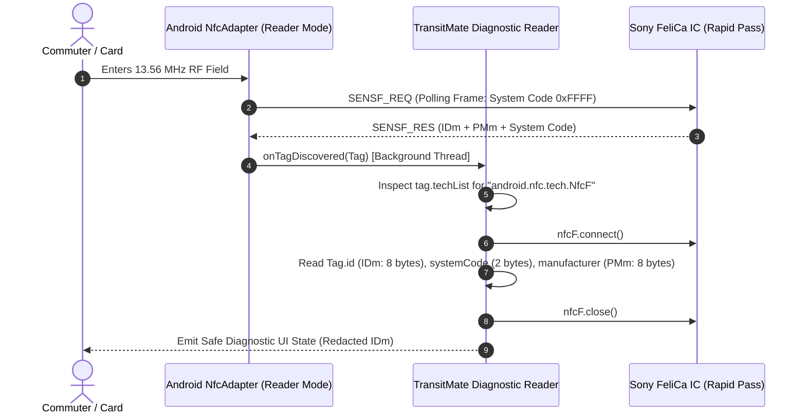

# TransitMate — Phase 03: NFC & FeliCa Technical Research Report

**Document Version:** 1.0  
**Date:** 12 November 2026  
**Status:** Approved Technical Baseline  
**Author:** Senior Android NFC/FeliCa Engineer & Technical Research Analyst  
**Card Under Test:** Bangladesh Rapid Pass (Physical Card Available)  
**Card Blocked:** Bangladesh MRT Pass (`BLOCKED — CARD NOT AVAILABLE`)  

---

## 1. Executive Summary & Objectives

The primary objective of Phase 03 is to establish an evidence-based technical foundation for contactless smart card communication in TransitMate. This report investigates:
1. Low-level RF standards (ISO/IEC 18092, JIS X 6319-4) and Android's native `android.nfc.tech.NfcF` APIs.
2. The specific smart card architecture of the **Bangladesh Rapid Pass**, issued under the Dhaka Transport Coordination Authority (DTCA).
3. The technical boundaries between **tag discovery metadata** (anticollision polling) and **application-level memory access** (service and block reading).
4. An architectural and legal audit of reference implementations (notably `aniruddha-adhikary/mrt-buddy`), enforcing strict license compliance and independent clean-room engineering.

---

## 2. RF Protocols & Android Contactless Standards

### 2.1 Comparison of Contactless Standards Relevant to Android

| RF Standard | Primary Specification | Data Rate | Modulation / Coding | Typical Global Applications | TransitMate Relevance |
|---|---|---|---|---|---|
| **NFC-F (FeliCa)** | **JIS X 6319-4 / ISO/IEC 18092** | **212 kbps / 424 kbps** | **Manchester coding, 10% ASK** | **Dhaka Rapid Pass & MRT Pass (JICA AFC)**, Suica/Pasmo (Japan), Octopus (HK) | **CRITICAL (Primary target for Rapid Pass)** |
| **NFC-A** | ISO/IEC 14443-3A | 106 kbps – 848 kbps | Modified Miller, 100% ASK | MIFARE Classic/DESFire, EMV contactless (Visa/Mastercard) | Secondary (Fallback detection) |
| **NFC-B** | ISO/IEC 14443-3B | 106 kbps – 848 kbps | NRZ-L, 10% ASK | e-Passports (ICAO 9303), French Navigo (Calypso) | Not applicable to Rapid Pass |
| **NFC-V** | ISO/IEC 15693 | 26.48 kbps | Pulse Position, 100% or 10% ASK | Vicinity RFID, warehouse inventory, smart library tags | Not applicable |

### 2.2 Why NFC-F / FeliCa in Bangladesh Public Transit?
The automated fare collection (AFC) systems for both the **Dhaka Metro Rail (MRT Line 6)** and the **DTCA Rapid Pass multi-modal transport network** were designed and financed under technical cooperation agreements with the **Japan International Cooperation Agency (JICA)**. JICA-sponsored AFC implementations historically mandate Sony FeliCa (NFC-F) IC technology due to its sub-100 millisecond transaction speed at busy fare gates.

---

## 3. Android NFC Architecture & API Investigation

### 3.1 Tag Dispatch Mechanics: Reader Mode vs. Foreground Dispatch

Android provides three mechanisms to interact with NFC tags:
1. **Reader Mode (`NfcAdapter.enableReaderMode`):** *Recommended & Required for TransitMate.*
   - Introduced in Android 4.4 (API 19).
   - Allows an activity to request exclusive control of the NFC controller when in the foreground.
   - Bypasses Android's default system sound, vibration, and intent-resolution popup.
   - Uses flags (`FLAG_READER_NFC_F | FLAG_READER_SKIP_NDEF_CHECK | FLAG_READER_NO_PLATFORM_SOUNDS`) to filter for specific technologies and suppress system UI chime conflicts.
   - Tag delivery occurs asynchronously via a callback (`NfcAdapter.ReaderCallback`) executed on a system binder background thread.
2. **Foreground Dispatch (`NfcAdapter.enableForegroundDispatch`):**
   - Older pattern using `PendingIntent`.
   - Delivers tags via `onNewIntent(Intent)`.
   - Still triggers system sounds and requires complex lifecycle state handling in Compose activities.
3. **Intent Filters (`AndroidManifest.xml` Action Dispatch):**
   - Launches or resumes the app when a tag matches intent filters (`ACTION_TECH_DISCOVERED`).
   - Slower and prone to app-chooser dialogs if other transit apps are installed on the user's phone.

### 3.2 Android `Tag` and `NfcF` Lifecycle

When a card is placed in the RF field:
1. **Discovery:** Android's NFC service performs polling. If a card responds to the SENSF_REQ polling frame, Android constructs an `android.nfc.Tag` object.
2. **Technology Inspection:** Querying `tag.techList` returns an array of fully qualified class names. For a FeliCa card, `android.nfc.tech.NfcF` must be present.
3. **Acquisition:** `val nfcF = NfcF.get(tag)` returns an `NfcF` handle or `null` if the technology is absent or unsupported by the hardware.
4. **Connection:** `nfcF.connect()` initiates the direct communication channel.
5. **Transceive:** `nfcF.transceive(byteArray)` transmits raw command frames and awaits responses.
6. **Disconnection:** `nfcF.close()` terminates the channel and releases the RF controller.



### 3.3 Threading, Timeouts, and Error Semantics

- **Strict Main-Thread Isolation:** `nfcF.connect()`, `transceive()`, and `close()` perform blocking I/O against the local NFC chip via IPC. Calling any of these methods on Android's main thread triggers UI stutters or `NetworkOnMainThreadException`-style ANR conditions. All NFC operations must run on `Dispatchers.IO`.
- **Timeout Management:** `nfcF.timeout` defaults to ~200–500 ms depending on handset OEM firmware. If a card is removed mid-read or the antenna coupling is weak, `nfcF.transceive()` blocks until the timeout expires and throws `java.io.IOException`.
- **`TagLostException`:** Thrown if the user pulls the card away before the RF response completes. The harness must catch `TagLostException` specifically and emit a transient `TagLost` diagnostic state rather than crashing.
- **Resource Leak Prevention:** `nfcF.close()` must always execute inside a Kotlin `try ... finally` or `.use { }` construct. Failing to close `NfcF` locks the NFC hardware controller, preventing subsequent tag detection until the phone screen is toggled.

### 3.4 Handset OEM Hardware Variations
- **NFC Controller Vendors:** Handsets in the Bangladesh market feature diverse NFC chips (NXP Semiconductors, Broadcom, STMicroelectronics, and Unisoc).
- **FeliCa Polling Sensitivity:** Unlike domestic Japanese smartphones (which carry Osaifu-Keitai and dedicated FeliCa hardware certification), global/international Android handsets often have lower RF coupling efficiency for NFC-F compared to NFC-A. The user must hold the card steadily within 1–2 cm of the phone's physical antenna (often near the top camera module or center battery).

---

## 4. Discovery Metadata vs. Application Memory Access

A critical engineering principle in contactless smart cards is the distinction between **Anticollision Discovery Metadata** and **Application-Level Data Access**:

```
+-----------------------------------------------------------------------------+
| 1. DISCOVERY METADATA (Publicly Broadcasted during RF Anticollision)        |
| - IDm (8 Bytes): Manufacturer ID & Chip Serial Number                       |
| - PMm (8 Bytes): IC Code & Maximum Response Time Parameters                 |
| - System Code (2 Bytes): Card ecosystem identifier (e.g., 0x88B4, 0xFE00)   |
| STATUS: Read-Only, Unencrypted, Legitimate, Safely Observable via Android   |
+-----------------------------------------------------------------------------+
                                      |
                                      v
+-----------------------------------------------------------------------------+
| 2. APPLICATION MEMORY ACCESS (Requires Service Codes & Read Commands)       |
| - Area / Service Code Table: Hierarchical memory map                        |
| - Service Code Properties: Read-Only vs. Read/Write, Protected vs. Open     |
| - 16-Byte Data Blocks: Stored balance, trip logs, station sequence numbers  |
| STATUS: Subject to Service Authentication / Access Restrictions              |
+-----------------------------------------------------------------------------+
```

### What Discovery Metadata Proves:
- The presence of an authentic NFC-F / FeliCa contactless tag.
- Handset hardware capability to detect and poll 212/424 kbps FeliCa carriers.
- Unique hardware tag identification (`Tag.id` / `IDm`).

### What Discovery Metadata DOES NOT Prove:
- It does **not** prove that memory blocks containing balance or transactions are unencrypted.
- It does **not** reveal whether the card uses FeliCa Standard, FeliCa Lite-S, or a secure dual-interface smart card operating system.
- It does **not** provide permission to bypass security access controls.

---

## 5. Bangladesh Rapid Pass Technical Investigation

### 5.1 Card Architecture & Issuing Authority
- **Issuing Authority:** Dhaka Transport Coordination Authority (DTCA), Ministry of Road Transport and Bridges.
- **Clearing House & Banking Partner:** Dutch-Bangla Bank Limited (DBBL).
- **Core Standard:** Automated Fare Collection (AFC) system developed under JICA technical assistance.
- **Physical Specifications:** Contactless smart card embedding an IC chip compliant with ISO/IEC 18092 / JIS X 6319-4.

### 5.2 Analysis of the Official Rapid Pass App (`com.bd.rapidpass.app`)
- **Package ID:** `com.bd.rapidpass.app`
- **Developer:** DTCA / Datasoft / Joint AFC Developer Consortium.
- **NFC Functionality:** The official app includes an NFC card-tap feature allowing commuters to read current card balance and last transaction details directly.
- **Recharge Mechanism Analysis:**
  - Online recharge is initiated via mobile financial services (bKash, DBBL NexusPay, etc.).
  - **Crucial Architecture Finding:** Online money is **not** written to the card through the phone! The user must tap the physical card at an **Add Value Machine (AVM)** or station ticket office at metro/bus stations to write the updated balance to the chip.
  - This proves the card balance is an **offline stored-value purse on the chip**, subject to strict cryptographic write-keys held only by station AVMs and ticket vending gates.

### 5.3 On-Card vs. Server-Side Data Segregation
| Data Attribute | Location | Access Characteristic |
|---|---|---|
| Card IDm / Hardware Identifier | On-Chip | Publicly readable during RF polling |
| Stored Value Balance | On-Chip | Read without encryption if in open service; write protected |
| Rolling Trip History (10–20 records) | On-Chip | Circular buffer of recent transit taps |
| Account Registration & User Profile | Central DTCA Server | Linked by Card Serial / Phone Number; never on chip |
| Web Payment Pending Top-up | Central DTCA Server | Queued until physical AVM sync |

---

## 6. Reference Project Audit: MRT Buddy (`aniruddha-adhikary/mrt-buddy`)

### 6.1 License Compliance & Legal Isolation
- **Observed Repository License:** **GNU General Public License v3.0 (GPL-3.0)**.
- **Legal Obligation:** GPL-3.0 is a strong copyleft license. Incorporating, adapting, or linking GPL-3.0 code into TransitMate would compel the entire TransitMate codebase to be licensed under GPL-3.0.
- **Engineering Directive:** TransitMate operates under a **Clean-Room Engineering Protocol**.
  - **Zero Code Copying:** No source code, parser classes, or binary artifacts may be copied or ported.
  - **Independent Clean Architecture:** TransitMate utilizes its own architecture (`core/nfc`, `domain`, `data`, `feature/startup`) designed from scratch.
  - **Reference Constants Classification:** Any protocol constants observed in public repositories must be treated as unverified hypotheses until confirmed on our own physical card.

### 6.2 Reference-Observed FeliCa Parameters
The following constants are cataloged from public research for hypothesis testing only:

| Parameter | Reference Value | Classification | Meaning in Reference Context |
|---|---|---|---|
| Target System Code | `0x88B4` | `REFERENCE-OBSERVED — NOT YET VERIFIED ON OUR RAPID PASS CARD` | JICA AFC Dhaka Metro Transit System Code |
| Wildcard System Code | `0xFFFF` | `REFERENCE-OBSERVED — NOT YET VERIFIED ON OUR RAPID PASS CARD` | Wildcard system code polling all services |
| Balance Service Code | `0x100B` or `0x090F` | `REFERENCE-OBSERVED — NOT YET VERIFIED ON OUR RAPID PASS CARD` | Purported Read-Without-Encryption Balance Service |
| History Service Code | `0x108F` or `0x094F` | `REFERENCE-OBSERVED — NOT YET VERIFIED ON OUR RAPID PASS CARD` | Purported Read-Without-Encryption Trip Log Service |
| Read Command Code | `0x06` | `REFERENCE-OBSERVED — NOT YET VERIFIED ON OUR RAPID PASS CARD` | Standard Sony FeliCa Read Without Encryption |

> [!WARNING]  
> None of the above service codes or block structures are to be written into production code or assumed valid for Rapid Pass until verified through physical-device test execution.

---

## 7. Evidence Confidence Matrix & Source Catalog

| Source Title | URL | Source Type | What it Proves | What it Does NOT Prove | Evidence Confidence |
|---|---|---|---|---|---|
| **Android Developer: NfcF API** | `developer.android.com/reference/android/nfc/tech/NfcF` | Official Vendor Documentation | API signatures, lifecycle, and exception contracts | Card-specific memory layout | **VERIFIED (Platform API)** |
| **Android Developer: Advanced NFC** | `developer.android.com/develop/connectivity/nfc/advanced-nfc` | Official Vendor Documentation | Reader mode mechanics, threading, foreground dispatch | Handset OEM hardware quirks | **VERIFIED (Platform API)** |
| **DTCA Official Rapid Pass Portal** | `rapidpass.com.bd` | Official Government Authority | Rapid Pass is an IC contactless smart card under DTCA | Memory block addresses or crypto keys | **VERIFIED (Domain Fact)** |
| **Google Play: Rapid Pass App** | `play.google.com/store/apps/details?id=com.bd.rapidpass.app` | Official Application Store Listing | Rapid Pass supports smartphone NFC balance inquiry | Internal byte structures | **VERIFIED (Product Existence)** |
| **MRT Buddy Open Source Repo** | `github.com/aniruddha-adhikary/mrt-buddy` | Community Open-Source (GPL-3.0) | Independent community claims of FeliCa read capability | Official endorsement or Rapid Pass parity | **REFERENCE-OBSERVED** |

---

## 8. Technical Risks & Unresolved Questions

1. **Card Type Parity (MRT Pass vs. Rapid Pass):** While both utilize JICA-specified AFC fare gates, do they use identical System Codes (`0x88B4`) and Service Codes, or does DTCA utilize a distinct partition from DMTCL?
2. **Handset RF Variability:** Will low-cost MediaTek/Unisoc Android handsets widely used in Bangladesh reliably poll FeliCa tags without carrier-specific NFC firmware modifications?
3. **Data Freshness:** Does reading the on-card buffer show pending online top-ups, or strictly completed station taps? (Confirmed: offline chip data only reflects physical gate/AVM interactions).
